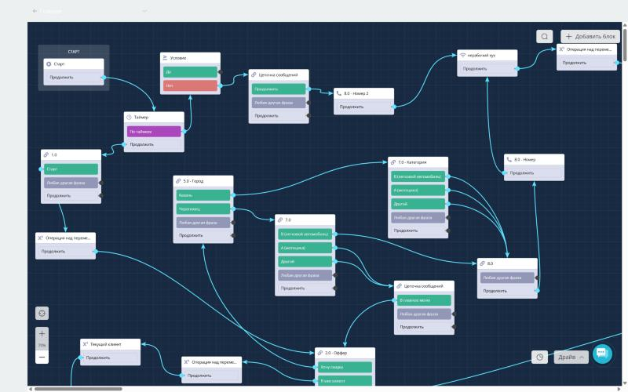
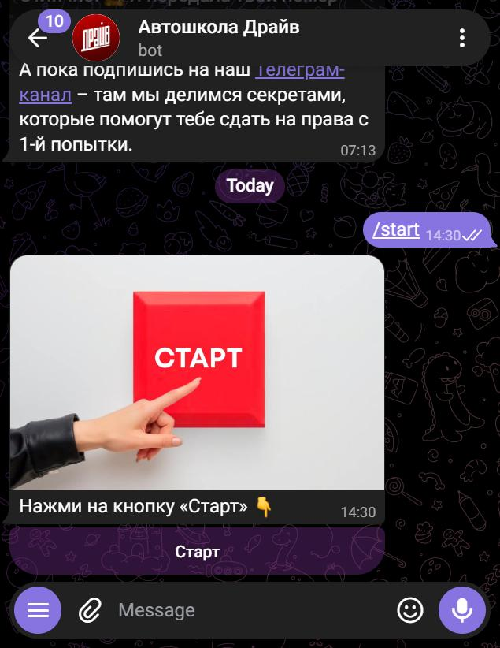
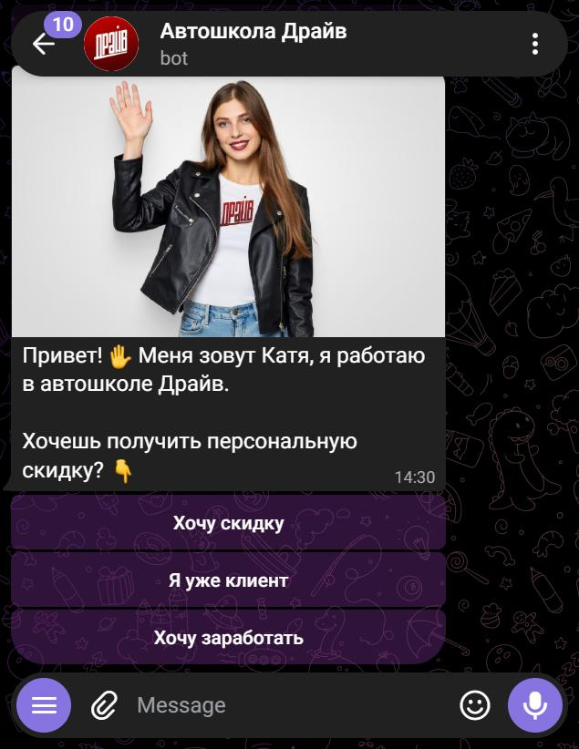
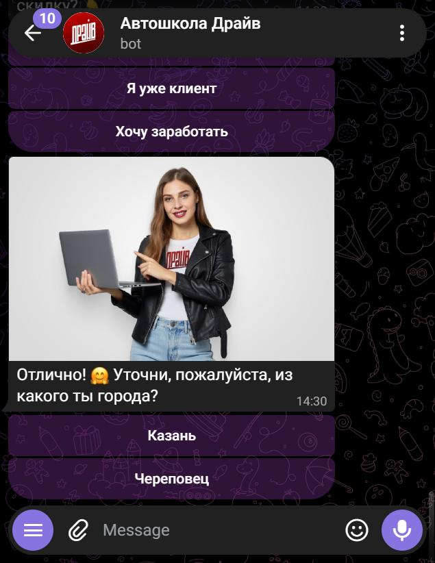
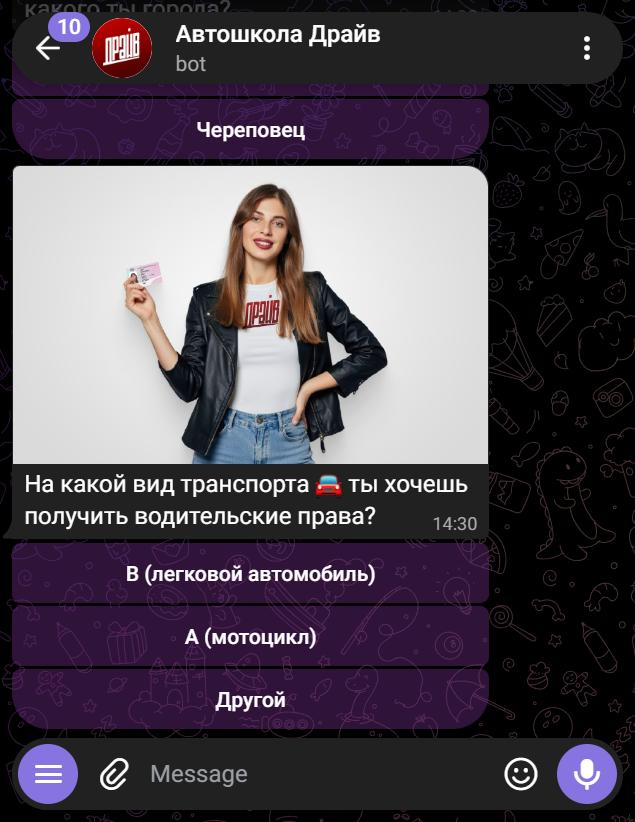
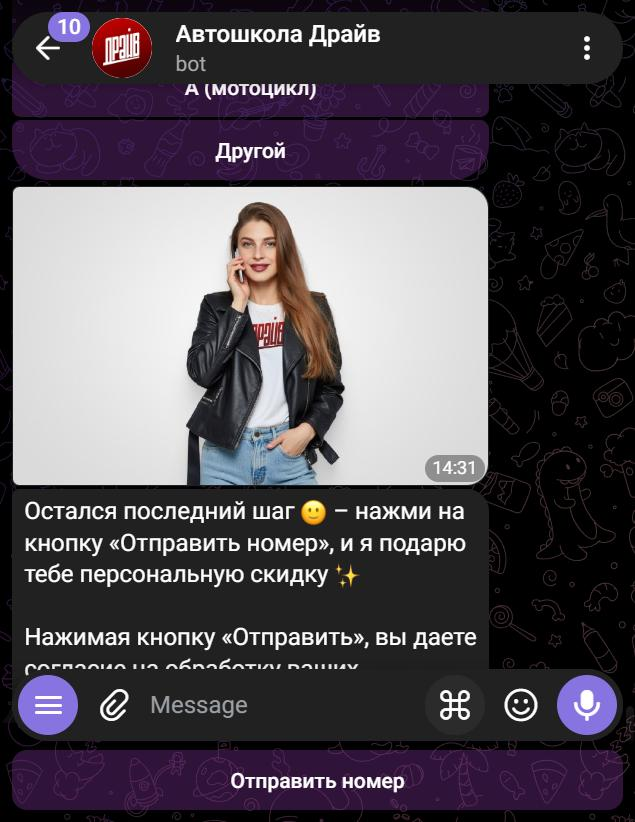
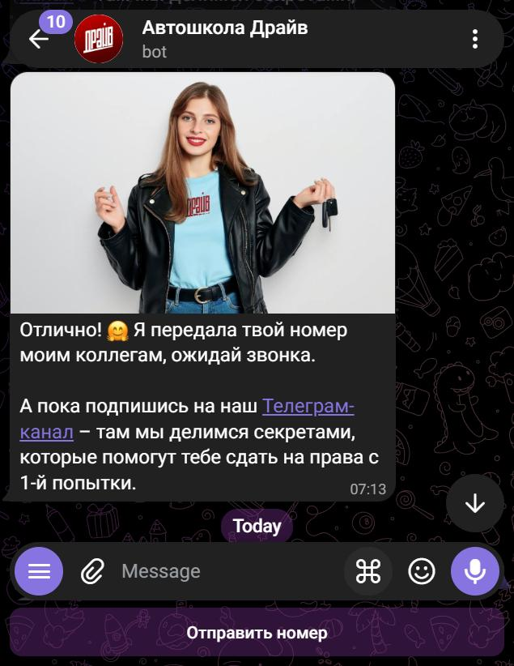
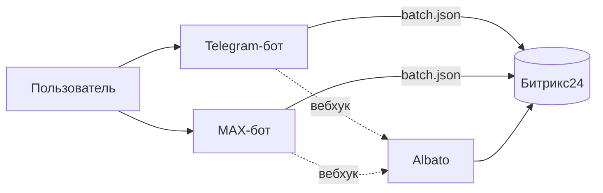
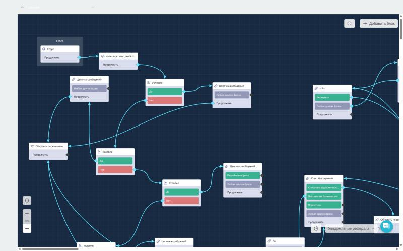

# Чат-боты автошколы «Драйв» (Telegram + MAX)

**Кейс автоматизации лидогенерации:** пользователь выбирает город и категорию прав в Telegram или MAX, оставляет контакт, а сценарий передаёт заявку в Битрикс24 и уведомляет менеджера. Если номер не оставлен, предусмотрено повторное касание через 24 часа.

**Что показывает проект:** проектирование ветвящихся сценариев в LeadTeh, интеграция с CRM через REST API / Albato, раздельная атрибуция источников и обезличенные выгрузки сценариев.

Сценарии лидогенерации и рассылок для сети автошкол (Казань, Череповец), собранные на конструкторе **LeadTeh** и интегрированные с **Битрикс24**.

> Сценарии спроектированы и собраны мной вручную в конструкторе LeadTeh: логика, тексты, интеграции с CRM.

## Как это выглядит в Telegram

<table><tr>
<td></td>
<td></td>
<td></td>
</tr><tr>
<td></td>
<td></td>
<td></td>
</tr></table>

Старт → оффер → город → категория прав → кнопка «Отправить номер» → заявка уходит в CRM, менеджер получает уведомление.

## Что умеют боты

- **Лидогенерация** — квалификация (город, категория прав), запрос телефона, сделка в нужной воронке CRM, уведомление менеджеру.
- **Дожим** — если человек не оставил номер, через 24 часа бот возвращается с персональной скидкой.
- **Рассылки** — отдельный источник в CRM для каждой рассылки, чтобы считать её эффективность.
- **Два мессенджера** — Telegram и MAX с общей логикой и разными ограничениями платформ.

## Архитектура

Заявки создаются одним запросом `batch.json` (контакт + сделка с `$result[create_contact]`), без промежуточных сервисов; часть сценариев работает через Albato.

## Сценарии

| Сценарий | Telegram | Описание |
|---|---|---|
| Главный сценарий: лидогенерация | [схема](telegram/main.md) · [json](telegram/main.json) | Квалификация лида (город → категория прав), запрос телефона, передача заявки в CRM, ветка «я уже клиент» → вопрос в поддержку, дожим через 24 часа таймером |
| Рассылка с оффером | [схема](telegram/mailing.md) · [json](telegram/mailing.json) | Сценарий для массовой рассылки: оффер → телефон → контакт и сделка напрямую в Битрикс24 одним batch-запросом с отдельным источником «Тг-бот Рассылка» для сквозной аналитики |
| Подписка на канал | [схема](telegram/subscription.md) · [json](telegram/subscription.json) | Проверка подписки на Telegram-канал для участия в розыгрыше |

MAX: [отличия и рассылка](max/README.md).

## Архив: реферальная программа в ботах

Раньше реферальная программа целиком жила в ботах: выдача ссылки, статусы приглашённых из CRM, сбор реквизитов на выплату, персональные ссылки менеджеров. Сейчас она перенесена в веб-кабинет, а схемы сохранены в [telegram/archive](telegram/archive).

| Сценарий | Схема | Описание |
|---|---|---|
| Реферальная программа: выдача ссылки | [схема](telegram/archive/referral_link.md) · [json](telegram/archive/referral_link.json) | Генерация персональной реферальной ссылки с UTM (телефон реферера + ID контакта), создание сделки реферера в отдельной воронке Битрикс24 |
| Реферальная программа: статусы и выплата | [схема](telegram/archive/referral_notifications.md) · [json](telegram/archive/referral_notifications.json) | Бот получает статус приглашённого из CRM (заявка → оплата → регистрация в ГИБДД), уведомляет реферера и собирает реквизиты для выплаты |
| Персональная ссылка менеджера (шаблон) | [схема](telegram/archive/personal_manager_template.md) · [json](telegram/archive/personal_manager_template.json) | Для каждого менеджера — свой стартовый сценарий: фиксирует ответственного (`assigned`) и запускает рефералку |

## Приёмы, которые стоит посмотреть

- **Batch-запрос в Битрикс24**: контакт и сделка создаются атомарно, сделка сразу привязана к контакту — [mailing.json](telegram/mailing.json).
- **Таймер-дожим** с проверкой флага «Будильник», чтобы не беспокоить тех, кто уже оставил номер — [main.json](telegram/main.json).
- **Разные источники в CRM** для бота, рассылки и мессенджера — эффективность каждого канала видна в отчётах.

## Как читать выгрузку

Каждый блок: `id`, `type`, `messages`/`http`/`conditions`, `buttons` с переходами `next`. Секреты (вебхук Битрикс24, Albato, токены, ссылки-приглашения) заменены на `<PLACEHOLDER>`.

Выгрузка обезличена: внутренние ID Битрикс24 заменены на говорящие плейсхолдеры, структура запросов сохранена.

| Плейсхолдер | Что это |
|---|---|
| `UF_CRM_SOURCE_NEW` | пользовательское поле сделки «Источник» (список) |
| `UF_CRM_BOT_CONTACT_ID` | ID контакта в конструкторе бота |
| `UF_CRM_TELEGRAM_ID` | Telegram ID клиента |
| `UF_CRM_PAY_TYPE` | способ выплаты реферального вознаграждения |
| `<SOURCE_NEW_TG_BOT>`, `<SOURCE_NEW_TG_MAILING>` | значения списка «Источник» для бота и рассылки |
| `<SOURCE_ID_TELEGRAM>`, `<SOURCE_ID_MAILING>` | стандартное поле SOURCE_ID |
| `<MAIN_PIPELINE_ID>`, `<REFERRAL_PIPELINE_ID>`, `<REFERRAL_STAGE_ID>` | воронки и стадия сделки |
| `<MANAGER_ID>` | ответственный сотрудник |
| `<REFERRER_ID>` | идентификатор реферера в UTM-метке реферальной ссылки |
