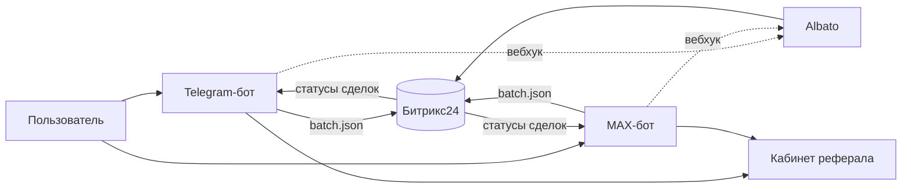

# Чат-боты автошколы «Драйв» (Telegram + MAX)

Сценарии лидогенерации, рассылок и реферальной программы для сети автошкол (Казань, Череповец), собранные на конструкторе **LeadTeh** и интегрированные с **Битрикс24**.

> Сценарии спроектированы и собраны мной вручную в конструкторе LeadTeh: логика, тексты, интеграции с CRM и Google Sheets.

## Что умеют боты

- **Лидогенерация** — квалификация (город, категория прав), запрос телефона, сделка в нужной воронке CRM, уведомление менеджеру.
- **Дожим** — если человек не оставил номер, через 24 часа бот возвращается с персональной скидкой.
- **Рассылки** — отдельный источник в CRM для каждой рассылки, чтобы считать её эффективность.
- **Реферальная программа** — персональная ссылка с UTM, статусы приглашённых из CRM (заявка → оплата → ГИБДД), сбор реквизитов и выбор способа выплаты.
- **Персональные ссылки менеджеров** — лид по ссылке сразу закрепляется за менеджером.
- **Два мессенджера** — Telegram и MAX с общей логикой и разными ограничениями платформ.

## Архитектура

Заявки создаются одним запросом `batch.json` (контакт + сделка с `$result[create_contact]`), без промежуточных сервисов; часть старых сценариев работает через Albato.

## Сценарии

| Сценарий | Telegram | Описание |
|---|---|---|
| Главный сценарий: лидогенерация | [схема](telegram/main.md) · [json](telegram/main.json) | Квалификация лида (город → категория прав), запрос телефона, передача заявки в CRM, ветка «я уже клиент» → вопрос в поддержку, дожим через 24 часа таймером и переход в реферальную программу |
| Рассылка с оффером | [схема](telegram/mailing.md) · [json](telegram/mailing.json) | Сценарий для массовой рассылки: оффер → телефон → контакт и сделка напрямую в Битрикс24 одним batch-запросом с отдельным источником «Тг-бот Рассылка» для сквозной аналитики |
| Подписка на канал | [схема](telegram/subscription.md) · [json](telegram/subscription.json) | Проверка подписки на Telegram-канал для участия в розыгрыше |
| Реферальная программа: выдача ссылки | [схема](telegram/referral_link.md) · [json](telegram/referral_link.json) | Генерация персональной реферальной ссылки с UTM (телефон реферера + ID контакта), создание сделки реферера в отдельной воронке Битрикс24 |
| Реферальная программа: статусы и выплата | [схема](telegram/referral_notifications.md) · [json](telegram/referral_notifications.json) | Бот получает статус приглашённого из CRM (заявка → оплата → регистрация в ГИБДД), уведомляет реферера и собирает реквизиты для выплаты; способ выплаты (деньги/списание долга) маппится JS-блоком в поле сделки |
| Персональная ссылка менеджера (шаблон) | [схема](telegram/personal_manager_template.md) · [json](telegram/personal_manager_template.json) | Для каждого менеджера — свой стартовый сценарий: фиксирует ответственного (`assigned`) и запускает общую рефералку |

MAX: [отличия и рассылка](max/README.md).

## Приёмы, которые стоит посмотреть

- **Batch-запрос в Битрикс24**: контакт и сделка создаются атомарно, сделка сразу привязана к контакту — [mailing.json](telegram/mailing.json).
- **JS-блок для маппинга**: текст кнопки «способ выплаты» → ID значения списка в CRM — [referral_notifications.json](telegram/referral_notifications.json).
- **Таймер-дожим** с проверкой флага «Будильник», чтобы не беспокоить тех, кто уже оставил номер — [main.json](telegram/main.json).
- **Кросс-бот уведомления**: сотрудник получает уведомление в том мессенджере, где работает.

## Как читать выгрузку

Каждый блок: `id`, `type`, `messages`/`http`/`conditions`, `buttons` с переходами `next`. Секреты (вебхук Битрикс24, Albato, токены, ссылки-приглашения) заменены на `<PLACEHOLDER>`; ID полей и воронок CRM оставлены как есть.
