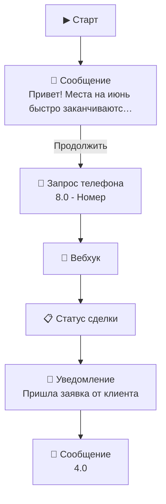

# MAX: рассылка

Рассылка в мессенджере MAX: лид передаётся в CRM через вебхук Albato.

## Схема

## Интеграции

- **🔗 Вебхук** — `GET <ALBATO_WEBHOOK>`

Полная выгрузка блоков — в соседнем `.json` (секреты заменены плейсхолдерами).
