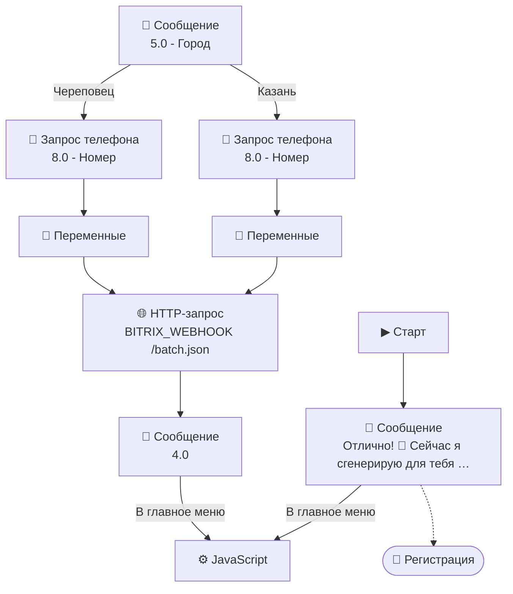

> **Архив.** Прежняя версия реферальной программы. Сейчас она перенесена из ботов в веб-кабинет реферала; схема сохранена, чтобы показать, как программа работала внутри мессенджера.

# Реферальная программа: выдача ссылки

Генерация персональной реферальной ссылки с UTM (телефон реферера + ID контакта), создание сделки реферера в отдельной воронке Битрикс24.

## Схема

## Переменные

`url`, `Город`

## Интеграции

- **🌐 HTTP-запрос** — `POST <BITRIX_WEBHOOK>/batch.json`

Полная выгрузка блоков — в соседнем `.json` (секреты заменены плейсхолдерами).
