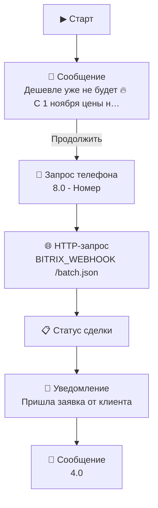

# Рассылка с оффером

Сценарий для массовой рассылки: оффер → телефон → контакт и сделка напрямую в Битрикс24 одним batch-запросом с отдельным источником «Тг-бот Рассылка» для сквозной аналитики.

## Схема

## Интеграции

- **🌐 HTTP-запрос** — `POST <BITRIX_WEBHOOK>/batch.json`

Полная выгрузка блоков — в соседнем `.json` (секреты заменены плейсхолдерами).
