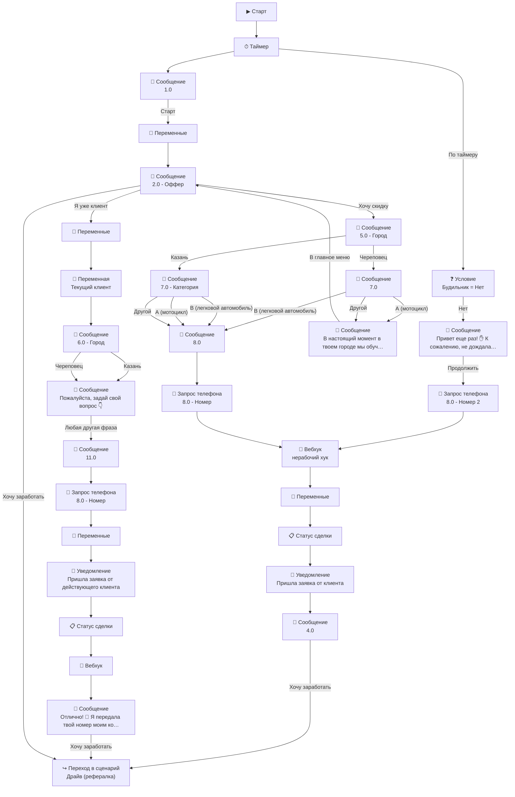

# Главный сценарий: лидогенерация

Квалификация лида (город → категория прав), запрос телефона, передача заявки в CRM, ветка «я уже клиент» → вопрос в поддержку, дожим через 24 часа таймером и переход в реферальную программу.

## Схема

## Переменные

`Будильник`, `Город`, `Комментарий`, `Имя`, `Фамилия`, `telegram_id`, `Категория`, `Оффер`

## Интеграции

- **нерабочий хук** — `GET <ALBATO_WEBHOOK>`
- **🔗 Вебхук** — `GET <ALBATO_WEBHOOK>`

Полная выгрузка блоков — в соседнем `.json` (секреты заменены плейсхолдерами).
