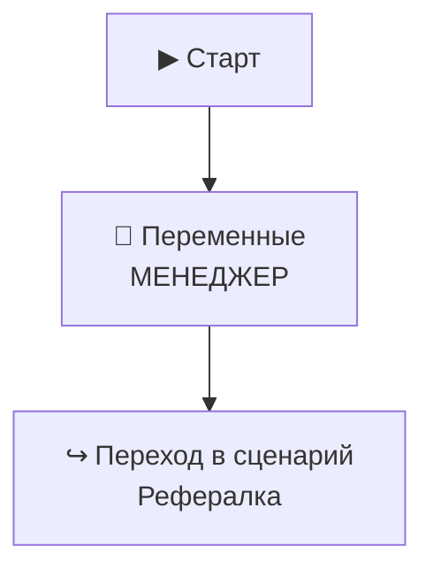

# Персональная ссылка менеджера (шаблон)

Для каждого менеджера — свой стартовый сценарий: фиксирует ответственного (`assigned`) и запускает общую рефералку. Так лиды по ссылке менеджера сразу падают на него в CRM.

## Схема

## Переменные

`assigned`

Полная выгрузка блоков — в соседнем `.json` (секреты заменены плейсхолдерами).
