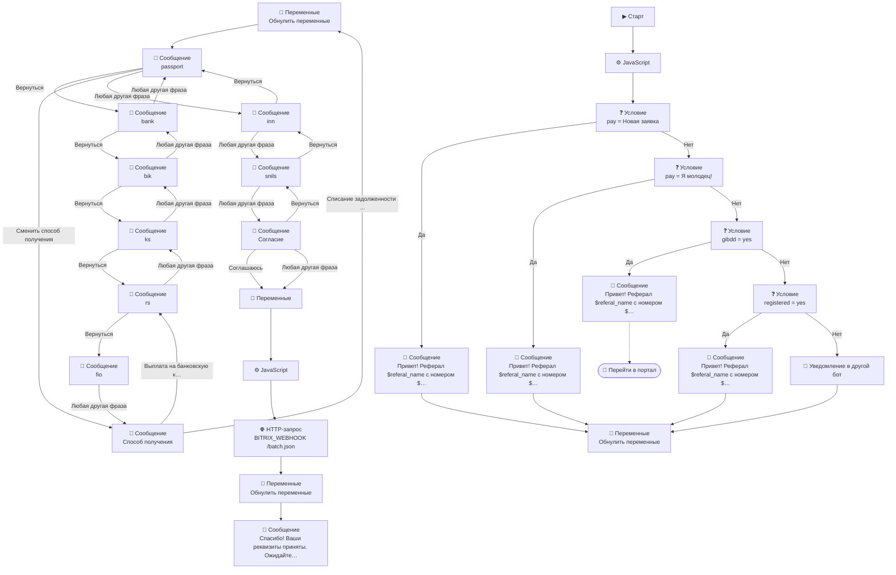

# Реферальная программа: статусы и выплата

Бот получает статус приглашённого из CRM (заявка → оплата → регистрация в ГИБДД), уведомляет реферера и собирает реквизиты для выплаты; способ выплаты (деньги/списание долга) маппится JS-блоком в поле сделки.

## Схема

## Переменные

`rs`, `ks`, `bik`, `bank`, `pay2`, `soglasen`, `snils`, `inn`, `passport`, `fio`, `pay`, `gibdd`, `registered`, `bank2`

## Интеграции

- **🌐 HTTP-запрос** — `POST <BITRIX_WEBHOOK>/batch.json`

Полная выгрузка блоков — в соседнем `.json` (секреты заменены плейсхолдерами).
